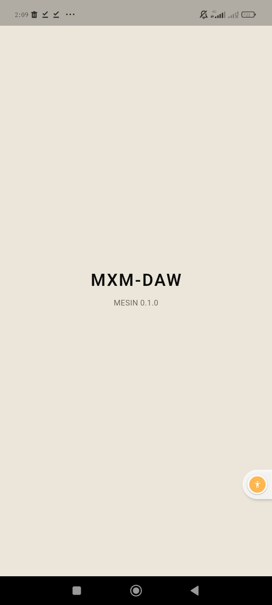

# Jurnal M0: Fondasi

- Periode: 2026-10-14
- Hasil: APK pratinjau `preview-18` dari halaman Releases, bertanda tangan
  kunci pemilik, terpasang di **Redmi 13C (Android 13)** dan menampilkan
  **`MESIN 0.1.0`** yang berasal dari Rust.

## Apa yang dibangun

| Langkah | Isi | PR |
|---|---|---|
| 0 | Rencana (`docs/rencana.md`) dan `AGENTS.md` | #1 |
| 1 | ADR 0001–0010, README, lisensi MIT OR Apache-2.0 | #2 |
| 2 | Workspace Rust `engine/` (`daw-core`, `daw-render`), CI `engine`, cargo-deny | #3 |
| 3 | Aplikasi Flutter `app/`, ikon buatan sendiri, CI `app` | #4 |
| 4 | Token warna MXM, tema terang/gelap, tes kontras WCAG (ADR-0011) | #5 |
| 5 | Jembatan Dart ↔ Rust (flutter_rust_bridge 2.13.0), `daw-ffi` | #6 |
| 6 | `libmxm_engine.so` (Rust + C++) di APK, `tools/cek-apk.sh`, CI `android` | #7 |
| 7 | Saluran pratinjau, kunci pemilik, rilis otomatis (ADR-0012) | #8 |
| 8 | Jurnal ini, README, panduan kunci | #9 |

## Bukti "selesai"

Setiap jenis bukti dicatat terpisah, karena masing-masing membuktikan hal
yang berbeda:

| Bukti | Yang dibuktikan |
|---|---|
| Tes di sesi agen (Rust 9, Dart 39, `tes-cek-apk.sh` 12, `tes-cek-tanda-tangan.sh` 7) | Logika dan pemeriksa bekerja, dan setiap tes sudah dibuktikan bisa gagal |
| CI hijau di `main` (run #18) | Format, lint, tes, lisensi, APK, izin, ABI, ekspor simbol, dan ukuran lolos di mesin bersih |
| `cek-tanda-tangan.sh` di run #18 | APK `preview-18` ditandatangani kunci yang sidik jarinya ada di repo |
| Pre-release `preview-18` | Rantai rilis bekerja; SHA-256 `bb3bfbc4…71fae` |
| **Tangkapan layar di HP pemilik** | Rantai lengkap Rust → cargo-ndk → CMake → APK → Releases → Redmi 13C → Dart → layar |
| Emulator | Belum ada (job emulator ditunda ke M1) |

## Angka

| Ukuran | Nilai |
|---|---|
| APK pratinjau arm64-v8a | 17,6 MB (batas 25 MB) |
| Fungsi Rust yang dicari Dart dan diekspor `libmxm_engine.so` | 15/15 |
| Izin di APK | Hanya `…DYNAMIC_RECEIVER_NOT_EXPORTED_PERMISSION` (disetujui pemilik); tanpa `INTERNET` |
| Waktu CI | `engine` ±20 s, `app` ±1 menit, `android` ±3,5–5 menit |
| Rust untuk Android (cargo-ndk, run pertama) | 22,8 s |
| Latensi, underrun, CPU | Belum diukur; diukur di M1 |

## Keputusan pemilik di M0

- Jawaban §17 (ADR-0009): HP acuan Redmi 13C, potret dulu, arm64-v8a saja, kit
  disintesis, kunci dibuat sendiri, belum punya kontroler MIDI.
- Warna grup C `#8A857C` dan grup D `#B0612F` (ADR-0011), karena cokelat
  `#7A3F17` hanya 2,13:1 dan 1,78:1 di atas tombol gelap.
- Izin androidx `DYNAMIC_RECEIVER_NOT_EXPORTED_PERMISSION` boleh ada, untuk ID
  rilis dan pratinjau (PR #7).

## Pelajaran

1. **Hitung dulu, baru tulis.** Kontras semua pasangan warna dihitung sebelum
   token ditulis. Hasilnya, satu warna rencana ternyata tidak terlihat, dan
   pemilik bisa memutuskan sebelum ada kode yang bergantung padanya.
2. **CI yang hijau belum tentu benar.** Tanpa `--whole-archive`, APK tetap
   terbangun, tetapi 0 dari 15 fungsi Rust diekspor, sehingga di HP mesin akan
   gagal dimuat. Simulasi link di host menemukannya, dan `cek-apk.sh` kini
   menjaganya.
3. **Asumsi tentang alat pihak ketiga harus diperiksa.** Ada empat asumsi saya
   yang salah: nama simbol flutter_rust_bridge (`frbgen_*` ternyata `frb_*`),
   `rustfmt --edition 2018` yang tertanam di generator, ABI tambahan dari
   plugin Gradle Flutter, dan format keluaran `apksigner`.
4. **Pemeriksa juga butuh tes.** `tes-cek-apk.sh` menemukan bug di
   `cek-apk.sh` sendiri: daftar izin kosong membuat skrip berhenti tanpa
   pesan (`grep` + `set -e`). Menjalankan potongan skrip CI dengan `keytool`
   sungguhan menemukan baris `SHA256:` yang diawali tab.
5. **Alat yang memasang dirinya sendiri harus dikunci.** Generator memasang
   `cargo-expand` versi terbaru tanpa diminta; kini versinya dikunci di CI.
6. **Jalur rahasia diuji tanpa rahasia.** Di PR, CI membuat kunci sekali
   pakai, sehingga Gradle `signingConfigs` dan `apksigner` sudah teruji
   sebelum kunci pemilik pertama kali dipakai.
7. **Perintah interaktif dijalankan satu per satu.** Tiga `gh secret set` yang
   ditempel bersama `gh auth login` tidak menyimpan apa pun. Panduan kunci kini
   memisahkan setiap perintah.
8. **Bedakan galat kita dan galat layanan.** Job rilis gagal karena HTTP 500
   dari API GitHub. Job itu diulang sekali (hanya job yang gagal) dan berhasil.
   APK yang sudah lolos pemeriksaan tidak dibangun ulang.
9. **Penyamaran secret berlaku untuk semua teks.** Karena alias kunci bernilai
   `pratinjau`, GitHub mengganti kata itu dengan `***` di nama langkah CI.
   Itu tidak berbahaya, tetapi menunjukkan bahwa nilai secret sebaiknya tidak
   berupa kata yang umum.
10. **APK artefak ≠ APK rilis.** APK dari artefak CI (kunci debug atau sementara)
    sempat terpasang lebih dulu. Ia harus di-uninstall sebelum `preview-18` bisa
    dipasang, karena tanda tangannya berbeda. Hal yang sama akan menimpa proyek
    pengguna bila kunci pratinjau pernah berganti (ADR-0012).

## Utang yang dibawa ke tahap berikutnya

- Pemeriksaan lisensi paket Dart otomatis di CI (ADR-0010) belum ada; lisensi
  saat ini dibaca manual.
- Job emulator (`integration`, rencana §13.3) ditunda ke M1.
- `gh release create` belum punya percobaan ulang otomatis untuk galat
  sementara.
- Layar pembuka Android masih putih sesaat sebelum Flutter tampil.
- Font Inter dan JetBrains Mono belum dipasang.

## Latihan sebelum M1

1. Buka tab Actions, run #18. Cari langkah "Siapkan kunci tanda tangan" dan
   jelaskan dengan kata-kata Anda sendiri kenapa langkah itu punya tiga cabang
   (`pemilik`, `sementara`, `tidak-ada`).
2. Di `tools/sidik-kunci-pratinjau.txt`, ubah satu karakter sidik jari di
   salinan lokal, lalu bayangkan push ke `main`: langkah mana yang merah, dan apa
   yang tertulis di log? (Jangan push perubahan ini.)
3. Gambar ulang rantai "dari `daw_core::engine_version()` sampai teks di layar
   HP" dari ingatan: crate, alat, berkas, dan bahasa di setiap langkah. Lalu
   bandingkan dengan README dan ADR-0003.
4. Kenapa APK pratinjau dan rilis memakai application ID berbeda? Apa yang
   terjadi pada proyek Anda bila keduanya memakai ID yang sama tetapi kunci
   berbeda?

## Berikutnya: M1, mesin audio

Oboe masuk ke adapter C++, Rust merender satu kick sintetis, dan panel
kesehatan mesin menampilkan latensi serta underrun. Bukti selesainya adalah
latensi dan underrun yang terukur di Redmi 13C, plus 10 menit tanpa underrun.
