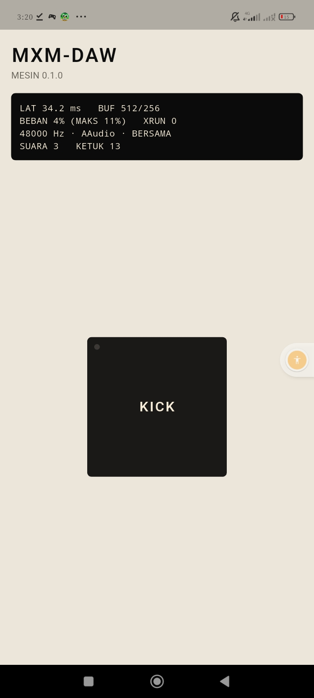

# Jurnal M1: Mesin audio

- Periode: 2026-10-14
- Hasil: `preview-24` di **Redmi 13C** membunyikan kick dari Rust lewat Oboe.
  Panel kesehatan mesin menampilkan latensi, underrun, dan beban callback
  apa adanya.

## Apa yang dibangun

| Langkah | Isi | PR |
|---|---|---|
| 1 | Mesin Rust: kick sintetis, antrean bebas-lock, render tanpa alokasi, `daw-render kick` (ADR-0013) | #10 |
| 2 | Oboe 1.10.0 (adapter C++), pad kick, panel kesehatan, stream berhenti di latar | #11 |
| 3 | Jurnal ini | #12 |

Sejak M1, PR di-merge oleh agen setelah CI hijau, atas izin eksplisit pemilik.

## Angka di HP pemilik (Redmi 13C, Android 13)

| Ukuran | Hasil | Target (rencana §11) | Catatan |
|---|---|---|---|
| Latensi keluaran (Oboe) | **34,2 ms** | ≤ 20 ms bila ada jalur rendah-latensi | Tidak tercapai; dicatat apa adanya (ADR-0009) |
| Underrun (XRUN) | **0** | 0 dalam 10 menit | Saat tangkapan layar, sesudah 13 ketukan |
| Beban callback | **4 %** rata-rata, **11 %** maks | ≤ 50 % | Banyak ruang untuk FX di M5 |
| Buffer / burst | 512 / 256 frame | buffer mulai 2 × burst | `LatencyTuner` tidak perlu menaikkannya |
| Mode stream | AAudio, 48 kHz, **BERSAMA** | Exclusive bila diizinkan | HP menolak mode eksklusif |

**Kenapa 34 ms?** Satu burst 256 frame pada 48 kHz = 5,3 ms, dan buffer 512 =
10,7 ms. Sisanya (±23 ms) ada di jalur audio vendor dan mixer Android, karena
mode eksklusif ditolak sehingga stream lewat mixer bersama. Bagian itu di luar
kendali aplikasi. Yang masih bisa dicoba (M9, optimasi): meminta ukuran buffer
1 × burst saat tanpa underrun, dan mengukur sentuh → bunyi dengan mikrofon HP
kedua (rencana §11).

## Bukti

| Bukti | Status |
|---|---|
| Tes Rust (22) dan Dart (44), termasuk tanpa alokasi dan alur FFI | ✅ |
| CI hijau, APK lolos `cek-apk.sh` dan `cek-tanda-tangan.sh` | ✅ |
| Kick terdengar di HP, panel menampilkan angka | ✅ (tangkapan layar) |
| 10 menit tanpa underrun | ⚠️ XRUN 0 tercatat, tetapi durasi 10 menit **belum dikonfirmasi** pemilik secara eksplisit |
| Sentuh → bunyi ≤ 50 ms (rekaman mikrofon kedua) | Belum diukur |
| Baterai: stream berhenti di latar | Diuji tes widget; belum diukur 30 menit di HP |

## Pelajaran

1. **Tes yang lolos pada kode salah itu tes yang lemah.** Tes "tanpa klik" hanya
   memeriksa sampel pertama, padahal sampel itu selalu `sin(0) = 0`. Mutasi
   (rampa dihapus) membongkar kelemahan ini, dan tesnya diperketat.
2. **`assert_no_alloc` menghentikan proses, bukan panic.** Bukti bahwa tes bisa
   gagal harus dibuat lewat mutasi, bukan `catch_unwind`.
3. **Binding dan pustaka harus sepasang.** Pustaka host lama ditolak
   flutter_rust_bridge karena hash API berbeda. Aturan ini melindungi HP dari
   APK yang setengah diperbarui.
4. **HP murah sering menolak mode eksklusif.** Panel yang jujur langsung
   menunjukkannya ("BERSAMA"), jadi tidak perlu menebak.
5. **Cache CI ikut berubah bila `Cargo.lock` berubah.** Job Android PR #10 butuh
   ±5 menit karena semua dependensi dikompilasi ulang.

## Utang yang dibawa

- Konfirmasi 10 menit tanpa underrun dan ukur sentuh → bunyi.
- Event dimainkan di awal blok (selisih ≤ 1 blok); tepat-sampel di M3.
- Pencurian suara bisa berbunyi klik (suara tertua dipotong); fade singkat di M2.
- Utang M0 yang tersisa: lisensi Dart otomatis, job emulator, retry rilis,
  layar pembuka putih, font.

## Berikutnya: M2, pad dan sampler dasar

Grup A dengan 16 pad, kit pabrik yang disintesis, impor WAV, editor
start/end, pitch, ADSR, filter, choke, dan velocity.
