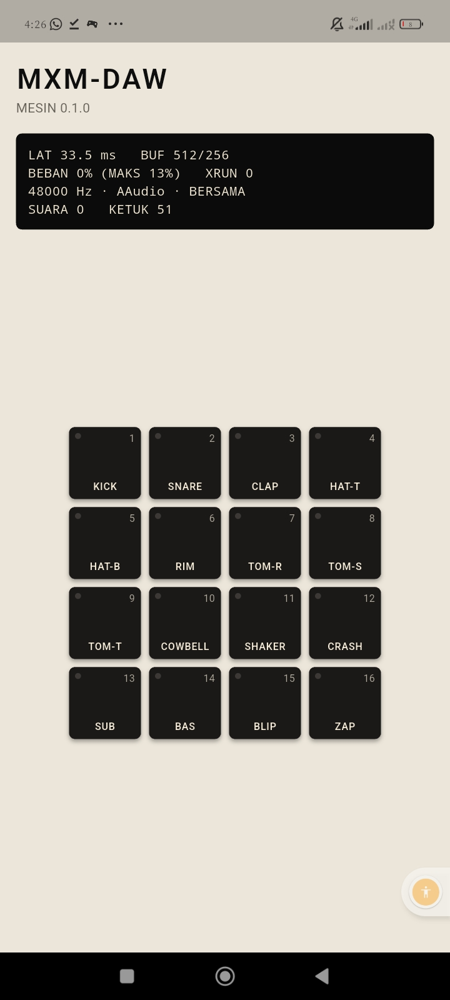

# Jurnal M2: Pad dan sampler dasar

- Periode: 2026-10-14
- Hasil: 16 pad kit pabrik yang disintesis bisa dimainkan di **Redmi 13C**,
  disunting di halaman Sound, dan diganti dengan WAV milik pemilik.

## Apa yang dibangun

| Langkah | Isi | PR |
|---|---|---|
| 1 | Mesin sampler: Hermite, ADSR, SVF, 32 suara, choke, one-shot/gate/loop, kit pabrik sintetis 16 suara, ADR-0014 | #13 |
| 2 | Kisi 16 pad, multi-sentuh, LED dari mesin | #14 |
| 3 | `PadBank` (model bertahan saat stream berhenti), halaman Sound, komponen Kenop | #15 |
| 4 | Crate `daw-io` (decode WAV dari byte), impor lewat Storage Access Framework | #16 |
| 5 | Jurnal ini | #17 |

## Bukti

| Bukti (rencana §14) | Status |
|---|---|
| Kit dimainkan di HP | ✅ Tangkapan layar: 16 pad, 51 ketukan, XRUN 0 |
| Sampel milik pemilik berhasil diimpor | ✅ Dilaporkan pemilik ("semua aman"); tangkapan layar halaman Sound sesudah impor tidak dikirim |
| Tes Rust dan Dart | ✅ Rust: 42 daw-core, 6 daw-io, alur FFI lengkap, tanpa alokasi. Dart: 63 |
| CI hijau di semua PR M2 | ✅ |
| Izin APK tidak bertambah | ✅ `cek-apk.sh` lolos, karena SAF tidak butuh izin |

## Angka di HP pemilik

| Ukuran | M1 | M2 | Catatan |
|---|---|---|---|
| Latensi keluaran | 34,2 ms | 33,5 ms | Masih mode bersama; target ≤ 20 ms belum tercapai |
| Beban callback maks | 11 % | 13 % | 32 suara sampler + filter, jauh di bawah 50 % |
| Underrun | 0 | 0 | |

## Pelajaran

1. **Tempat menyimpan model menentukan umurnya.** Parameter pad semula ada di
   objek yang ikut dibuang saat aplikasi ke latar. Kesalahan ini ditemukan
   **sebelum** editor dibuat, karena alurnya ditelusuri dulu: "apa yang
   terjadi bila layar mati?" `PadBank` sekarang hidup lebih lama daripada
   stream.
2. **Thread audio juga tidak boleh membebaskan memori.** Sampel lama
   dikembalikan ke UI lewat antrean sampah. Mutasinya terbukti: bila sampel
   dibebaskan di render, tes `tanpa_alokasi` abort.
3. **Event bisa tiba lebih cepat daripada frame.** Kenop menghitung dari nilai
   lama, sehingga gerakan cepat hilang. Tes widget dengan `tester.drag`
   menemukannya.
4. **Format berkas diurai dari byte, bukan jalur.** `daw-io` bisa dites tanpa
   HP, dan SAF tidak butuh izin penyimpanan.
5. **Sintesis memberi kit yang deterministik.** Hasil kit bisa dites per sampel
   dan dirender ulang dengan `daw-render kit`.

## Utang yang dibawa

- Impor hanya WAV; AIFF, FLAC, MP3, dan OGG belum (rencana §4.2).
- Belum ada snap ke zero-crossing atau zoom gelombang (M6).
- Loop bisa berbunyi klik di titik sambung (crossfade di M6).
- SHIFT + pad (pilih tanpa bunyi) belum ada.
- Velocity tetap (bukan dari posisi) belum bisa dipilih.
- Sampel impor belum disimpan ke disk; hilang bila aplikasi ditutup paksa
  (simpan proyek di M4).
- Utang lama: latensi > 20 ms, sentuh → bunyi belum diukur, tidak ada job
  emulator, lisensi Dart belum otomatis.

## Berikutnya: M3, sequencer

Pola 1–16 bar pada 960 PPQN, rekam langsung dengan metronom dan count-in,
timing correct yang tidak merusak, swing, dan grid langkah. Bukti selesainya:
beat 4 bar direkam di HP, serta tes timing dan golden lulus.
