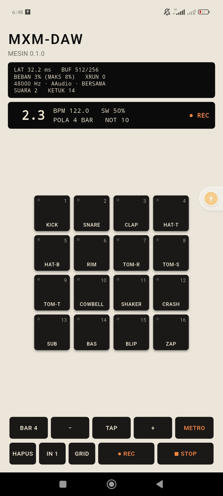
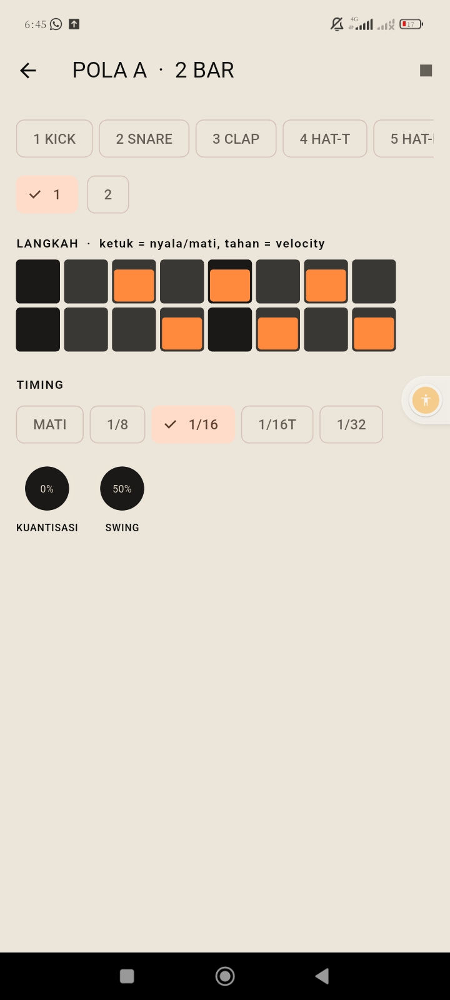

# Jurnal M3: Sequencer

- Periode: 2026-10-14
- Hasil: beat **4 bar direkam langsung dari pad** di Redmi 13C dengan count-in
  dan metronom. Pemilik menilai ketukan hasil rekaman terdengar **tepat** di
  ketukan.

## Apa yang dibangun

| Langkah | Isi | PR |
|---|---|---|
| 1 | Mesin sequencer 960 PPQN tepat-sampel, metronom, count-in, rekaman dengan kompensasi latensi, tes timing dan golden, ADR-0015 | #18 |
| 2 | Layar segmen BAR.BEAT, panel transport (BAR, BPM, TAP, METRO, IN, HAPUS, REC, PLAY) | #19 |
| 3 | Halaman Pola: grid langkah, velocity, kuantisasi tidak merusak, swing | #20 |
| 4 | Perbaikan dari uji HP, dan jurnal ini | #21 |

## Bukti

| Bukti (rencana §14) | Status |
|---|---|
| Beat 4 bar direkam di HP | ✅ Tangkapan layar: POLA 4 BAR, 10 not, sedang merekam di 2.3 |
| Timing terdengar tepat | ✅ Dinilai pemilik dengan telinga ("tepat"); belum diukur dengan alat |
| Tes timing | ✅ 300 not dalam 100 bar pada 123,4 BPM tepat di sampelnya; hasil sama persis untuk ukuran blok berbeda |
| Tes golden | ✅ RMS per 100 ms dari beat demo; mutasi swing membuatnya gagal |
| Tanpa alokasi | ✅ Termasuk transport, rekaman, dan ganti pola; mutasi membuktikan tesnya bisa gagal |
| Underrun saat merekam | ✅ XRUN 0; beban maks 8 % |

## Pelajaran

1. **Bug yang tidak terdengar tetap bug.** Tempo f32 123,4 sebenarnya
   123,40000153; setelah 100 bar not bergeser satu sampel. Tes timing yang
   membandingkan dengan rumus menemukannya, telinga tidak akan menemukannya.
2. **Batas blok adalah tempat bug bersembunyi.** Not yang jatuh tepat di frame
   pertama blok berikutnya ikut blok ini dan berbunyi satu sampel terlalu cepat.
   Keputusan dipindah ke ruang *frame*, bukan *tick*.
3. **Kesalahan yang sama muncul lagi di bentuk lain.** Tombol BPM ± memakai
   nilai lama saat diketuk cepat, persis seperti kenop di M2. Polanya kini
   jelas: kirim *perubahan* (fungsi), bukan *nilai jadi*.
4. **Tes widget tidak melihat apa yang dilihat mata.** Chip pad yang tergeser
   keluar layar, cincin kenop yang pucat, dan ▶ yang menjadi emoji hanya
   terlihat di HP. Tangkapan layar pemilik adalah alat uji.
5. **Golden memakai sidik jari, bukan hash.** RMS per 100 ms tahan terhadap
   perbedaan satu bit antar sistem, tetapi tetap menangkap not yang bergeser.

## Utang yang dibawa

- Ketukan dari layar dimainkan di awal blok (±5 ms), belum tepat-sampel.
- Grid belum bisa mengatur panjang not atau menggeser mikro-timing.
- Pola dan sampel impor belum disimpan ke disk (M4: simpan otomatis).
- Satu pola per grup; 99 pola, salin/tempel, dan undo di M4.
- Timing sentuh → bunyi belum diukur dengan mikrofon kedua.
- Utang lama: latensi 32 ms (> 20 ms), tidak ada job emulator, lisensi Dart
  belum otomatis.

## Berikutnya: M4, grup, keys, proyek (MVP)

Grup A–D, mode KEYS, note repeat, salin/tempel, undo/redo, dan **simpan
otomatis**. Bukti selesainya: proyek tetap utuh setelah aplikasi ditutup paksa
lalu dibuka lagi.
